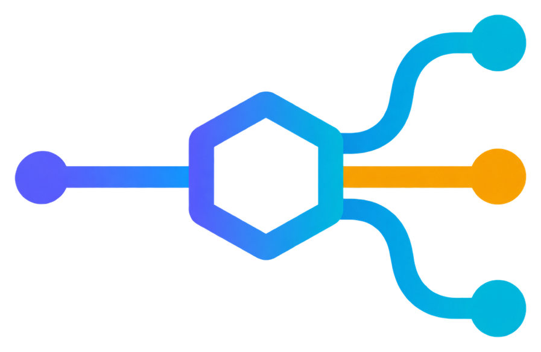
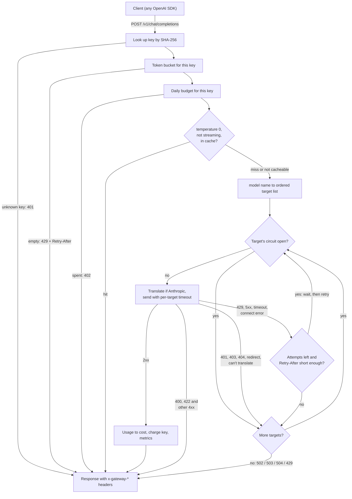

<p align="center">
  
</p>

# llm-gateway

An OpenAI-compatible HTTP gateway that sits in front of several LLM providers. Apps talk
to it with any OpenAI SDK. Behind it, each model name maps to an ordered list of
upstreams. It falls back between them, retries with backoff, skips providers that are
down, enforces per-key rate limits and daily spend budgets, and translates to and from
Anthropic's Messages API, streaming included.

```text
$ curl -s localhost:8080/v1/chat/completions \
    -H "Authorization: Bearer sk-gw-local-dev-key" \
    -d '{"model": "smart", "messages": [{"role": "user", "content": "hi"}]}' -D - -o /dev/null
HTTP/1.1 200 OK
content-type: application/json
x-gateway-provider: anthropic
x-gateway-model: claude-sonnet-4-5-20250929
x-gateway-attempts: 1
x-gateway-cache: bypass
x-gateway-cost-usd: 0.00007400
x-request-id: e5df7381-d7f9-47e7-9688-cd9872bf7b68
content-length: 273
date: Fri, 25 Sep 2026 12:11:37 GMT
```

That output came from a local run against a fake Anthropic server, which is also how the
tests work.

It's written in Rust on Axum, Tokio and reqwest. It's a single binary with a TOML config
file and no database.

## Why I built this

Once you have a few apps calling a few LLM vendors, the same code starts showing up in
all of them. Retry on 429. Maybe retry on 500. Switch to the other vendor when the first
one is having a bad day. Count tokens so someone can tell you what last month cost.
Every app does it slightly differently, and none of them do it well, because it's never
the point of the app.

I wanted to try putting all of that in one place. Apps get one URL, one key and model
names like `smart` or `fast`. The gateway deals with provider outages, rate limits and
spend.

The other reason was to learn how the OpenAI and Anthropic wire formats differ. On
paper they carry the same information. In practice system prompts live in different
places, tool calls are shaped differently, tool results go in different roles, and the
streaming formats are quite far apart. OpenAI sends one kind of chunk over and over.
Anthropic sends typed events per content block. Writing a translator that turns one into
the other, chunk by chunk, taught me more about both APIs than reading the docs did.

## What I looked at

- The OpenAI Chat Completions reference, for request fields, the chunk format, the
  `stream_options.include_usage` usage chunk and the error shape.
- Anthropic's Messages API and streaming docs, for `message_start`,
  `content_block_*`, `message_delta` and the `input_json_delta` events that carry tool
  arguments.
- The WHATWG Server-Sent Events spec, to get the parser right. The details that matter
  are `\r\n` line endings, comment lines, multi-line `data:` fields, and events split
  across TCP reads.
- Marc Brooker's post on exponential backoff and jitter on the AWS Architecture Blog.
  The gateway uses "full jitter" from that post.
- Martin Fowler's write-up of the circuit breaker pattern, for the closed, open and
  half-open states.
- LiteLLM's proxy, which already does most of this and a lot more. I wanted something
  small enough that I understand every line of it.

## How a request flows



The code follows the diagram fairly closely:

| File | What it does |
|------|--------------|
| `src/gateway.rs` | The request path and the dispatch loop: targets, attempts, backoff, breakers, accounting |
| `src/providers.rs` | Building upstream requests per provider kind, parsing responses, relaying streams |
| `src/anthropic.rs` | OpenAI to Anthropic request translation, and Anthropic to OpenAI responses and stream events |
| `src/circuit.rs` | Circuit breaker state machine |
| `src/ratelimit.rs`, `src/auth.rs` | Token bucket, key hashing, daily budgets |
| `src/backoff.rs` | Jittered exponential backoff, `Retry-After` and `retry-after-ms` parsing |
| `src/cache.rs` | LRU with TTL and canonical request hashing |
| `src/sse.rs` | Incremental SSE parser |
| `src/config.rs` | TOML config and startup validation |
| `src/clock.rs` | A clock trait, so tests can move time forward instead of sleeping |

## Fallback, retries and circuit breaking

Each model name in the config maps to an ordered list of targets. A target is a provider
plus the upstream model ID, with an optional timeout and a list of request fields to
drop. For each target, in order:

1. If the provider's circuit is open, skip it without sending anything.
2. Translate the request if the target is Anthropic. If the request can't be expressed
   for it, say `n: 3` or JSON mode, move on to the next target.
3. Send the request with the target's timeout. For streaming requests the timeout covers
   the time until response headers arrive. After that, `stream_idle_timeout_ms` limits
   the gap between chunks.
4. On success, return.
5. On 429, 5xx, 408, a timeout or a connection error, count a failure against the
   circuit and retry the same target up to `retry.max_attempts` times. The wait is the
   upstream's `Retry-After` or OpenAI's `retry-after-ms` when it sends one. Otherwise
   it's a random delay between zero and `base_delay_ms * 2^retry`, capped at
   `max_delay_ms`.
6. If `Retry-After` is longer than `retry.max_retry_after_ms`, don't wait. Move to the
   next target.
7. On 401, 403 or a redirect, count a failure and move to the next target without
   retrying. Those mean the gateway's own credentials or `base_url` for that provider
   are wrong, and retrying won't fix that. The gateway never follows redirects, since
   that would send provider keys to another host.
8. On 404, move to the next target without retrying and without counting a failure.
   Targets use different model IDs, so one upstream not knowing its model says nothing
   about the next one.
9. On any other 4xx, return the upstream's error to the client. Every target gets the
   same messages and parameters, so a 400 or 422 would most likely come back from all of
   them.

If every target fails, the client gets a single error that lists what happened to each
attempt. The status depends on how it failed. It's 429 with a `Retry-After` if the last
target was rate limiting, 503 if every circuit was open, 504 on a timeout, and 502
otherwise. If every upstream answered 404, it's a 404. If no target could take the
request at all, it's the 400 from the translator. Anthropic's 529 "overloaded" counts as
a 5xx.

Here is one from a run where Anthropic answered 529 twice and OpenAI timed out twice,
with `timeout_ms = 2000`. The client got a 504:

```json
{"error":{"code":"upstream_timeout","message":"all upstream targets for model \"smart\" failed: anthropic (claude-sonnet-4-5-20250929): HTTP 529: {\"type\":\"error\",\"error\":{\"type\":\"overloaded_error\",\"message\":\"Overloaded\"}}; anthropic (claude-sonnet-4-5-20250929): HTTP 529: {\"type\":\"error\",\"error\":{\"type\":\"overloaded_error\",\"message\":\"Overloaded\"}}; openai (gpt-5): timed out after 2000ms; openai (gpt-5): timed out after 2000ms","param":null,"type":"upstream_error"}}
```

There is one circuit breaker per provider:

- **Closed.** Requests go through. `failure_threshold` consecutive failures open it. A
  success resets the count.
- **Open.** Requests skip this provider straight away, so a dead upstream costs nothing
  but a mutex lock.
- **Half-open.** After `cooldown_ms`, exactly one request goes through as a probe. If it
  succeeds, the circuit closes. If it fails, the circuit opens for another full
  cooldown. Other requests keep skipping the provider while the probe is in flight.

A 400 or 422 means the upstream is up and answering, so it counts as healthy. For a
stream, the breaker hears the outcome when the stream ends, not when the headers
arrive. A stream that dies halfway, stalls past the idle timeout or ends with an error
event counts as a failure. A client hanging up doesn't. A probe whose client disconnects
before the upstream answers frees the probe slot, so the breaker can't get stuck
half-open.

## Translating between OpenAI and Anthropic

Anthropic targets get OpenAI-shaped requests translated on the way in, and responses
translated on the way out:

| OpenAI | Anthropic |
|--------|-----------|
| `system` and `developer` messages | top-level `system` |
| `assistant.tool_calls[]`, arguments as a JSON string | `tool_use` blocks, input as an object |
| one `tool` message per result | `tool_result` blocks in a single `user` turn |
| `image_url` with a data URL or https URL | `image` block with a `base64` or `url` source |
| `max_tokens` / `max_completion_tokens`, optional | `max_tokens`, required (`default_max_tokens` fills it in) |
| `tool_choice: "required"` / `{"function": ...}` | `{"type": "any"}` / `{"type": "tool", "name": ...}` |
| `parallel_tool_calls: false` | `disable_parallel_tool_use: true` |
| `stop` | `stop_sequences` |
| `usage.prompt_tokens` | `input_tokens + cache_creation_input_tokens + cache_read_input_tokens` |

Streaming is where they differ most. The translator is a small state machine in
`src/anthropic.rs`. It turns each Anthropic event into zero or more OpenAI chunks:

| Anthropic event | OpenAI chunk |
|-----------------|--------------|
| `message_start` | `delta: {role: "assistant", content: ""}` |
| `content_block_start` (tool_use) | `delta.tool_calls[i]` with `id`, `name` and empty `arguments` |
| `content_block_delta` (text_delta) | `delta.content` |
| `content_block_delta` (input_json_delta) | `delta.tool_calls[i].function.arguments` fragment |
| `message_delta` | empty delta with `finish_reason` (`tool_use` becomes `tool_calls`, `max_tokens` becomes `length`) |
| `message_stop` | usage chunk if the client asked for one, then `[DONE]` |
| `error` | `{"error": {...}}` payload, then the stream ends |
| `ping`, thinking and signature deltas | nothing |

Anthropic numbers content blocks across text, thinking and tool use. OpenAI numbers tool
calls on their own. So the translator keeps a map from block index to tool call index.

For OpenAI upstreams the gateway always sets `stream_options.include_usage`, so it can
bill streams. If the client didn't ask for usage, the gateway drops that extra chunk
before it reaches them, along with the `"usage":null` field OpenAI then adds to every
chunk. Otherwise it forwards chunks byte for byte. If the stream is cut off partway
through an event, the gateway drops the half event rather than forwarding it, as the
SSE spec says.

## Configuration

The full example is [`gateway.toml`](gateway.toml). Every field and its default is
documented in [`src/config.rs`](src/config.rs). The important parts:

```toml
[retry]
max_attempts = 2           # tries per target, including the first
base_delay_ms = 250
max_delay_ms = 4000
max_retry_after_ms = 10000 # a longer Retry-After skips to the next target

[circuit_breaker]
failure_threshold = 5
cooldown_ms = 30000

[cache]
enabled = true             # temperature 0, non-streaming only
ttl_secs = 300

[providers.anthropic]
kind = "anthropic"
base_url = "https://api.anthropic.com"
api_key_env = "ANTHROPIC_API_KEY"
timeout_ms = 120000            # until response headers
stream_idle_timeout_ms = 60000 # longest gap between stream chunks

[providers.openai]
kind = "openai"             # any OpenAI-compatible server works
base_url = "https://api.openai.com/v1"
api_key_env = "OPENAI_API_KEY"

[[models]]
name = "fast"
targets = [
  { provider = "anthropic", model = "claude-haiku-4-5-20251001", timeout_ms = 30000 },
  { provider = "openai", model = "gpt-5-mini", timeout_ms = 30000, drop_params = ["temperature", "top_p"] },
]

[prices."claude-haiku-4-5-20251001"]
input_per_mtok = 1.00
output_per_mtok = 5.00
cached_input_per_mtok = 0.10   # cache reads
cache_write_per_mtok = 1.25    # cache writes, which Anthropic bills separately

[[keys]]
name = "local-dev"
key_sha256 = "0aa0e62bf20dcb7164fae29389a20211e478364686d319676b38d3a89b4611f3"
requests_per_minute = 60
daily_budget_usd = 5.00
```

`drop_params` exists because some models reject parameters that others accept. The
GPT-5 family rejects `temperature`, and Anthropic restricts combinations of sampling
parameters. Dropping incompatible parameters prevents a request from failing on a fallback.

Config validation collects every problem before failing, so a bad file can be fixed in
one pass:

```text
$ llm-gateway check --config broken.toml
error: invalid configuration (3 problems):
  - providers.anthropic.api_key_env: environment variable ANTHROPIC_API_KEY is not set or is empty
  - models[1] ("fast").targets[0]: unknown provider "anthropc" (known: anthropic, openai)
  - keys[0] ("local-dev").key_sha256 must be 64 hex characters; store the hash from `llm-gateway hash-key`, not the key itself
```

It also rejects unknown fields, so a typo like `rpm = 60` fails loudly instead of doing
nothing.

## Quickstart

With Rust installed:

```sh
export ANTHROPIC_API_KEY=sk-ant-...
export OPENAI_API_KEY=sk-...
cargo run --release -- --config gateway.toml
```

The example config expects both keys. If you only use one provider, delete the other
provider and its targets. The example config has a local key, `sk-gw-local-dev-key`, to
get started with:

```sh
curl localhost:8080/v1/chat/completions \
  -H "Authorization: Bearer sk-gw-local-dev-key" \
  -H "Content-Type: application/json" \
  -d '{"model": "fast", "stream": true, "messages": [{"role": "user", "content": "Write a haiku about retries"}]}'
```

Or from any OpenAI SDK:

```python
from openai import OpenAI

client = OpenAI(base_url="http://localhost:8080/v1", api_key="sk-gw-local-dev-key")
reply = client.chat.completions.create(
    model="smart",
    messages=[{"role": "user", "content": "Hello"}],
)
```

Make real keys with `llm-gateway gen-key`. It prints a new key and the hash to put in
the config. To hash a key you already have, pipe it into `llm-gateway hash-key`. Reading
it from stdin keeps it out of your shell history.

With Docker:

```sh
docker build -t llm-gateway .
docker run --rm -p 8080:8080 -e ANTHROPIC_API_KEY -e OPENAI_API_KEY llm-gateway

# with your own config
docker run --rm -p 8080:8080 -e ANTHROPIC_API_KEY -e OPENAI_API_KEY \
  -v "$PWD/my-gateway.toml:/etc/llm-gateway/gateway.toml:ro" llm-gateway
```

The image is a multi-stage build onto `distroless/cc`, running as a non-root user and
logging JSON. It comes to about 12 MB of compressed layers on arm64. On SIGTERM the gateway stops accepting connections and gives in-flight
requests, streams included, up to `shutdown_grace_ms` to finish.

## Endpoints, headers and metrics

| Endpoint | Auth | Notes |
|----------|------|-------|
| `POST /v1/chat/completions` | key | OpenAI Chat Completions, streaming and non-streaming |
| `GET /v1/models` | key | Lists the configured model names |
| `GET /healthz` | none | `{"status": "ok", "circuits": {"anthropic": "closed", ...}}` |
| `GET /metrics` | none | Prometheus text format |

The gateway accepts keys as `Authorization: Bearer <key>` or `x-api-key: <key>`.

Every response carries `x-request-id`. The gateway uses the client's value if it sent a
sane one and generates a UUID otherwise. The same ID is sent to the upstream and appears
on every log line for the request. Responses from an upstream also carry
`x-gateway-provider`, `x-gateway-attempts` and `x-gateway-model`, which is the upstream
model ID. Non-streaming responses add `x-gateway-cost-usd`. When the cache
is enabled, `x-gateway-cache` is `hit`, `miss` or `bypass`.

All metric names start with `llm_gateway_`.

| Metric | Labels |
|--------|--------|
| `requests_total` | `key`, `model`, `status` |
| `request_duration_seconds` (histogram, time to response headers) | `model` |
| `upstream_attempts_total` | `provider`, `outcome` (`success`, `rejected`, `server_error`, `rate_limited`, `timeout`, `connect_error`, `network_error`, `auth_error`, `not_found`, `redirect`, `bad_response`, `stream_failed`, `circuit_open`) |
| `fallbacks_total` | `model` |
| `tokens_total` | `key`, `model`, `kind` (`prompt`, `completion`, `cached_prompt`, `cache_write_prompt`) |
| `cost_usd_total` | `key`, `model` |
| `key_spend_today_usd` | `key` |
| `cache_lookups_total` | `result` |
| `unbilled_streams_total` | `provider` |
| `rate_limited_total`, `budget_rejected_total` | `key` |
| `circuit_state` (0 closed, 1 open, 2 half-open), `circuit_transitions_total` | `provider` |

Label values only come from the config, meaning key, model and provider names, so a
client can't blow up the cardinality by sending made-up model names.

## Overhead

`benches/overhead.rs` runs a mock upstream and the real gateway router in one process on
localhost. It sends the same request alternately straight to the mock and through the
gateway, so both paths see the same conditions. Then it compares the latency
distributions. The mock answers instantly, so everything above the direct numbers is
time spent in the gateway and the extra network hop.

I measured this on an Apple Silicon laptop, an M4 Pro with 12 cores and 24 GB of memory
on macOS 27. It's a release build with `info` logging formatted as JSON and written to a
sink, so log formatting is included in the cost.

Non-streaming, one request at a time, 20,000 requests per path:

| path (microseconds)                |      p50 |      p90 |      p99 |    p99.9 |     mean |
|------------------------------------|----------|----------|----------|----------|----------|
| mock upstream directly (OpenAI)    |       31 |       52 |       77 |      139 |       36 |
| through gateway, passthrough       |       73 |      113 |      151 |      238 |       82 |
| added by gateway, passthrough      |       42 |       61 |       73 |       99 |       45 |
| mock upstream directly (Anthropic) |       30 |       51 |       77 |      141 |       36 |
| through gateway, translated        |       73 |      113 |      154 |      289 |       82 |
| added by gateway, translated       |       43 |       62 |       78 |      147 |       46 |

Streaming, 40 chunks per response, 5,000 requests per path:

| path (microseconds)                |      p50 |      p90 |      p99 |    p99.9 |     mean |
|------------------------------------|----------|----------|----------|----------|----------|
| direct, first byte                 |       62 |       87 |      128 |      167 |       63 |
| gateway, first byte                |      136 |      172 |      228 |      365 |      133 |
| added to first byte                |       74 |       85 |      100 |      198 |       70 |
| direct, whole stream               |      403 |      520 |      690 |      865 |      421 |
| gateway, whole stream              |      508 |      630 |      805 |     1097 |      518 |
| added to whole stream              |      105 |      109 |      115 |      233 |       97 |

Non-streaming, 32 concurrent clients, 40,000 requests per path:

| path                               |   p50 us |   p99 us |      req/s |
|------------------------------------|----------|----------|------------|
| mock upstream directly             |      299 |      761 |      98147 |
| through gateway                    |      562 |     1049 |      54628 |

So the gateway adds roughly 45 microseconds at p50 and 75 to 80 at p99 to a non-streaming
request, and the Anthropic translation costs about the same as passthrough. For streams
it adds about 70 microseconds to the first byte and about 100 over a 40-chunk stream.
A second run of the same build landed within about 15 microseconds of these numbers at
p50 and p99. The p99.9 column is noisier and moved by up to about 105 microseconds
between runs.

"Added" rows are the difference between the two percentiles, not a percentile of
per-request differences. Client, gateway and mock all share the same CPU, which hurts
the concurrent run most. Going through the gateway means twice the connections and twice
the HTTP parsing on the same cores, so the throughput figure is a floor, not a capacity
estimate. A model takes hundreds of milliseconds to several seconds to answer, so tens
of microseconds on top of that don't matter. I measured it to make sure that was true
rather than assume it.

Run it yourself with `cargo bench --bench overhead`. Set `BENCH_REQUESTS` and
`BENCH_CONCURRENCY` to change the run size.

## Tests

```sh
cargo fmt --all --check
cargo clippy --all-targets -- -D warnings
cargo test
docker build -t llm-gateway .
```

CI runs the same commands, see `.github/workflows/ci.yml`. Everything runs
offline, with no API keys.

There are 159 tests, and all of them pass: 113 unit tests in `src/` and 46 integration
tests in `tests/`. The integration tests break down as 25 for routing and circuit
breaking, 12 for streaming and the Anthropic adapter, 5 for the cache and 4 for auth,
limits and budgets. Once compiled, the test binaries run in about two seconds.

The unit tests cover config parsing and validation, the token bucket, the circuit breaker
state machine on a manual clock, backoff bounds and `Retry-After` parsing, cost
calculation, cache key canonicalisation, the SSE parser at every possible chunk
boundary, and the Anthropic translation against JSON and SSE fixtures in
`tests/fixtures/anthropic/`.

The integration tests start scriptable fake providers on random ports. Each one can be
told to succeed, fail with any status, send `Retry-After`, hang, or stream chunks with a
delay. The real gateway router runs in front of them on a manual clock. They check:

- fallback order, and retries on 5xx, 429, timeouts and refused connections
- that the retry after a `Retry-After: 1` comes at least a second later, and that a long
  `Retry-After` moves on to the next target instead
- that 4xx errors come back without retry or fallback and don't trip the circuit, while
  a 404 moves on to the next target
- that redirects are not followed, so provider keys never reach another host
- the circuit opening after N failures, skipping the provider, half-opening after the
  cooldown, and closing or reopening depending on the probe
- per-key rate limiting with 429 and `Retry-After`, budget exhaustion with 402, and the reset at
  midnight UTC
- cache hits on a reordered but identical request, TTL expiry, and per-key scoping
- OpenAI streams arriving chunk by chunk rather than all at the end, checked by arrival
  time
- Anthropic streams, text and tool calls, becoming valid OpenAI chunks that end in
  `[DONE]`, and mid-stream errors and truncated streams reaching the client as errors
- a stalled stream hitting the idle timeout, and a stream that fails halfway opening
  the circuit
- requests Anthropic can't express falling back to an OpenAI target
- request IDs reaching the upstream, and the metrics counters updating

## Known limitations

- **State is per process and in memory.** Rate limits, budgets, circuit breakers and the
  cache are not shared between replicas, and they reset on restart. Running several
  replicas means each key gets N times its limits.
- **Budgets can overshoot.** Cost is only known after a response, so the budget is
  checked before a request and charged after it. The request that crosses the line
  completes. So do any others already in flight.
- **Some streams go unbilled.** OpenAI only reports usage in the last chunk. If a client
  hangs up on an OpenAI stream before then, the gateway has no usage and records $0,
  even though the provider bills for the tokens it generated.
  `llm_gateway_unbilled_streams_total` counts these. Anthropic streams report input
  tokens up front, so they are partly billed.
- **Cost is an estimate.** Prices are static config. There is one cache write price,
  so Anthropic's 1-hour cache writes, which cost more than 5-minute ones, are
  underbilled. Models without a price entry count as free. The gateway warns about
  those at startup.
- **No fallback once a stream has started.** After response headers go out, a failure
  can only be reported to the client as an error chunk.
- **No overall deadline.** Worst case latency is roughly targets × attempts × timeout,
  plus backoff. Waiting on `Retry-After` holds the client connection open.
- **The Anthropic adapter covers the common subset.** `n > 1`, JSON mode through
  `response_format`, and audio or file content parts can't be translated. The gateway
  tries the next target for those, or returns a 400 if there isn't one. `logprobs`,
  `seed`, penalties and other OpenAI-only fields are dropped. Thinking blocks are not
  passed back. `temperature` is clamped to Anthropic's 0 to 1 range. System messages
  anywhere in the conversation are moved to the top-level `system` field.
- **The cache is bounded by entry count, not bytes.** The worst case memory use is
  `max_entries` times the largest response.
- **Only Chat Completions.** No embeddings, legacy completions or the Responses API.
- **`/metrics` and `/healthz` have no auth.** Keep them on an internal network.

## License

MIT. See [LICENSE](LICENSE).
